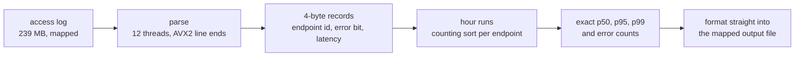

# Track A: Ingest

Read an access log and, for every hour and endpoint that saw traffic, print the request count,
the exact 50th, 95th and 99th latency percentiles, the error count and the errors per million.

| | Reference | Mine |
|---|---|---|
| Time, full dataset, seed 1 | 32.05 s | 16.6 ms |
| Peak memory | 228 MB | 16.9 MB |
| Code lines | 56 | 344 |
| Board points | 0 | 87.6 |

That's about 1,900 times the reference's speed on the board's dataset. If you only read one step
in [PERF.md](PERF.md), make it step 8, where the records started following the file's own order.

## Approach



1. The log is mapped and cut into one chunk per thread at line breaks. At 239 MB it's ten times
   the L3 cache, so it gets parsed exactly once; a second pass would stream it from main memory
   all over again.
2. Each thread turns a line into a 4-byte record: endpoint id, error bit and latency. AVX2
   compares find the line's end, and the latency, the status and the end of the endpoint name are
   read backwards from there at fixed offsets. The latency's digits convert in one SWAR step, and
   the rare latency too large for the record's 20 bits goes on a side list. Endpoint names become
   small integers through one table that all threads share, so a name is compared once per
   occurrence and never stored per line. The whole log ends up as 12 MB of records.
3. Lines arrive in long runs of the same hour, so the records stay in file order and each thread
   just notes where its runs of an hour start. No hour is stored per line, and nothing ever sorts
   the 3.1 million lines. That's step 8, and it freed the memory that made 4-byte records and the
   17 MB peak possible. The output order then falls out of one sort of the 1,842 endpoint names.
4. Threads take the hours one at a time, smallest first. For one hour, a thread walks that hour's
   runs in every chunk, counts lines per endpoint, places each latency with a counting sort and
   picks the percentiles by rank. An hour is about 43,000 lines, so its 170 KB latency buffer
   stays in L2 through the sort and the selection. Nearest rank on a counting sort is exact,
   which is why the hashes match the reference on every seed. Each hour's records are freed as
   soon as they're read, and that keeps the peak at 17 MB.
5. Once every hour's length is known, the output file gets its final size and is mapped. Each
   thread formats its hours straight into the file and gives those pages back. The process exits
   right after the write; by then the threads have returned their records and their share of the
   input to the kernel in parallel, and the input was unmapped before memory peaked.

## Dependencies

None, just the standard library.

```
cd track-a && cargo +1.99.1 build --release --offline
```

`.cargo/config.toml` links statically and asks for a plain static executable instead of a static
PIE. On this track that ran the same code in 3.9% fewer user cycles, with half the iTLB misses
(PERF.md, step 40).

## With another 24 hours

What's left is mostly the parse and the page faults the kernel takes around it. `perf` puts the
parse at 26% of kernel samples (`next_uptodate_folio`, fault-around), and 47% of the formatting
phase goes to `shmem` page-cache insertion. First I'd fault the output pages in before the hour
pass, so the formatter never takes a fault in its inner loop. Then I'd give the parse its own
mapped copy of the input and see whether fault-around scales with more threads. After that come
the two barriers and the leader's serial sort, which together cost 0.36 ms, 2.2% of the run.
