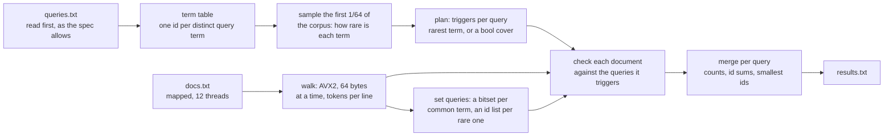

# Track B: Index

Answer 50,000 queries over a corpus of about 250,000 documents. For each query, print how many
documents match, the sum of their ids and the ten smallest ids. A query is either a boolean
expression, evaluated strictly left to right, or an exact phrase.

| | Reference | Mine |
|---|---|---|
| Time, full dataset, seed 1 | 56.35 s | 87.8 ms |
| Peak memory | 2,200 MB | 42.0 MB |
| Code lines | 91 | 947 |
| Board points | 0 | 79.5 |

About 640 times the reference's speed. B is the track I'd most like another shot at, and its
[PERF.md](PERF.md) is the longest of my four logs, failed experiments and all.

## Approach



1. `queries.txt` is read before the corpus (spec §3 allows it), and every distinct query term
   gets a small id. From then on the corpus is indexed only for terms the queries use. 79% of
   the corpus's tokens are query terms; the other 21% cost one hash lookup each and nothing more,
   and no posting list is ever written for a term no query mentions.
2. Tokenising the first 1/64 of the corpus estimates how many documents hold each term. Each
   query then gets triggers: terms such that every matching document contains at least one of
   them. A phrase uses its rarest term, and a boolean query uses a cover of its terms. Triggers
   only decide how much work gets done, so a bad estimate makes the run slower and can never
   change an answer.
3. One pass over the corpus does the rest. Each thread scans a chunk of whole lines, and an AVX2
   classifier turns every 64-byte block into three masks: token starts, token ends and line feeds.
   The token loop packs eight tokens at a time. At the end of each document, only the queries its
   triggers point at get checked, and only against that document. A phrase is checked at each
   position of its trigger term, and a boolean query takes one lookup in a truth table of which
   of its terms the document contains. Set operations done per document give the same answer as
   combining whole posting lists (spec §3).
4. A boolean query whose cover has a common term in it would get checked in far too many
   documents, so those run on whole sets instead: a bitset per common term and an id list per
   rare one, window by window, merged at the end.
5. Per query, the chunk counts and id sums add up, and the smallest ids come from the earliest
   chunks. Memory stays flat the whole way: per query a count, an id sum and the first matches,
   and per kept term one window of documents. No posting list for the whole corpus ever exists,
   which is how the peak stays at 42 MB next to the reference's 2.2 GB.

## Dependencies

No crates, only std.

```
cd track-b && cargo +1.99.1 build --release --offline
```

The build has one flag the other tracks don't: every loop starts on a 64-byte boundary, so the
pass's hot loops keep their speed when a change somewhere else moves their function (PERF.md,
step 21). Like A and C, it's a plain static executable at a fixed address, with no dynamic
loader and no position-independent code (PERF.md, step 30).

## With another 24 hours

The pass costs about 113 instructions per token, and 49% of the cycles sit in the line-end
closure that works through each line's probe list (PERF.md, after step 63). Past that the time
is spread thin, with no source line above 5.8% of the cycles. A third of the branch misses are
the tokenizer's loop exit, once per 64-byte block, which no history can predict. The start also
leaves about 6 ms of the 12 CPUs idle; step 66 parallelised its largest piece, for 2.9% locally
and 3.6% on the board.

The fastest B entries on the board run in about 62 to 66 ms, two of them in Rust, so my next day
would go into a second design: collect each query term's documents during the pass and answer
the queries on those sets afterwards, instead of checking at every line end. Memory has nothing left to give: the final code's runs use 41.8 to 42.2 MB,
already under the 44 MB cap, so a smaller peak wouldn't score anything.
