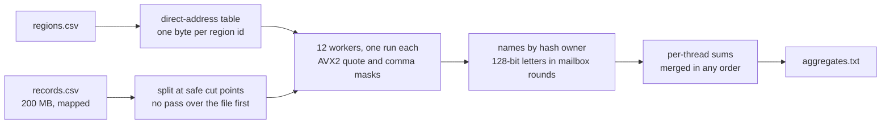

# Track C: Join

Join a 200 MB CSV of records against a small region table and print one line of aggregates per
country: record count, id sum, amount sum, min, max, distinct names, and the byte lengths of the
names and notes after unescaping.

The CSV is hostile on purpose. Names and notes are quoted, `""` stands for one `"`, a note can
hold a bare newline, records end in CRLF or LF, and a byte order mark can start any record. The
output still has to match the reference byte for byte.

| | Reference | Mine |
|---|---|---|
| Time, full dataset, seed 1 | 14.44 s | 19.3 ms |
| Peak memory | 367 MB | 11.3 MB |
| Code lines | 108 | 348 |
| Board points | 0 | 83.1 |

About 745 times the reference's speed. The step I'd point you to in [PERF.md](PERF.md) is step 9,
where sharding names by hash took the board time from 73.4 to 51.0 ms.

## Approach



1. The region lookup is a direct-address table. Countries are numbered in the order their first
   rows are read, and the table maps a region id to a group number in one byte. A missing id
   reads as group 0, the unmatched row, so the hot path has no comparison in it.
2. The file is cut into one run per worker, and a cut can land inside a quoted note, where a
   newline is just data. So each run starts at the first newline after its cut that a digit or a
   byte order mark follows (spec §2.2), and nothing has to scan the file before the real pass.
3. For each record, one AVX2 compare builds masks of the quotes and commas in the 64 bytes at the
   name, and the ends of the name and the note come out of both masks at once, so a record is
   walked field by field with no byte loop. A field's unescaped length is its raw length minus
   one per `""` pair, which means no field is ever copied or rewritten and the parser never
   allocates a string. The id converts from one 8-byte word, and the region id and amount from
   one 16-byte vector, with no digit loop.
4. Each distinct name belongs to one thread, which keeps a hash table with 64 bits of the name's
   hash and one bit per country. Threads trade 16-byte letters (a 128-bit hash plus the group) in
   rounds with a barrier between them. A table line never bounces between cores, and the only
   atomic left is one per thread per round, at the barrier, where the reference contends on every
   record.
5. Codes are written bytewise, so the country order falls out of the table without a sort, and
   the per-thread integer sums merge in any order.

The input stays mapped, and what the program allocates is the name sets, the mailboxes and the
region table.

## Dependencies

None again.

```
cd track-c && cargo +1.99.1 build --release --offline
```

It's a static, non-PIE executable like A and B (PERF.md, step 27). Static linking on its own
skips the dynamic loader, which took about 0.25 ms of start-up.

## With another 24 hours

What's left is the probe loop and the barrier waits. Names and notes are hashed while still
escaped, which is exact but reads every byte twice when a note is long, so a fast path for the
usual unquoted, unescaped field would shorten the parse. Memory is 11.3 MB against a 7.3 MB cap,
and the name sets and the mailbox pages are the two places where another megabyte would pay.
Twelve workers are 7% faster locally but lose about 4 points on one board run in five when the
box is busy; a cheap contention check inside the process that falls back to eleven workers would
keep the speed without that tail risk.
