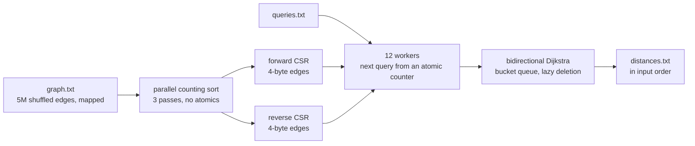

# Track D: Traverse

For each of 2,000 queries `(s, t)`, print the length of the shortest directed path from `s` to `t`
in a weighted road graph of 1.7 million nodes and 5 million edges, or `-1` when there isn't one.
The clock covers everything: reading the files, building the graph, the searches and the output.

| | Reference | Mine |
|---|---|---|
| Time, full dataset, seed 1 | 72.69 s | 118.4 ms |
| Peak memory | 893 MB | 65.7 MB |
| Code lines | 43 | 424 |
| Board points | 0 | 73.6 |

About 610 times the reference's speed. Step 5 in [PERF.md](PERF.md) is a good one to start with:
packing each edge into 4 bytes dropped the peak from 125.2 to 83.9 MB.

## Approach



1. There are two compressed graphs. One CSR groups every edge by its tail for the search from
   `s`, and a second groups them by head for the search from `t`, so either direction is one
   contiguous slice per node.
2. An edge is four bytes, with the neighbour in the low bits and the weight in the bits above it
   (21 and 11 at full scale). Nearly every road weight fits, and the rest go in a small side map.
   That halves both CSRs to 40 MB, so a search streams half the bytes and does half the page
   walks.
3. The build is a parallel counting sort in three passes, with one thread per chunk of lines and
   no atomics. The first pass counts each chunk's edges per block of 2,048 node ids, the second
   writes every edge into the run of the final array that belongs to its chunk and block, and the
   third sorts each block by a 2-byte place value. A block fits in L2. There's no comparison sort
   and no per-edge allocation, and the only big buffers are the CSRs and one `u16` place per
   edge. The build also faults its own arrays in with one write per 2 MB, so each huge page is
   first touched by a single thread instead of four at once.
4. Bidirectional Dijkstra grows one disc from `s` and one from `t` and stops soon after they
   meet. Two discs of half the radius cover about half the area of one full disc, and that's the
   biggest single gain over the reference. A target with no in-edges empties the backward
   frontier in one step, where a forward search would settle the whole graph.
5. Each side keeps its frontier in a bucket queue with lazy deletion and its tentative distances
   in a small hash map, so a search pays only for the nodes it touches.
6. Workers take the next unanswered query from a shared counter and each writes into its own
   slot. `main` prints the slots in input order, so the output never depends on scheduling.

## Dependencies

None here either, just the standard library.

```
cd track-d && cargo +1.99.1 build --release --offline
```

D's `.cargo/config.toml` sets nothing beyond `target-cpu=alderlake`, so unlike the other three
it isn't statically linked.

## With another 24 hours

The CSR alone is 40 MB and the memory cap is 17.9 MB, so the graph can't shrink much further
without a different layout, and the search already has a bucket queue with lazy deletion and a
two-step prefetch. What's left is the build, about 27 ms, and the queries themselves, which use
53% of the CPU and whose cost you can't tell from the query text. I'd run two experiments: split
the query batch by expected cost so the 12 workers finish together instead of draining one long
search at the end, and see whether the build's first pass can drop its 2-byte place array when
only the forward direction needs sorting. One idea I already measured and threw out was
relabeling node ids in BFS order. The searches got 9 ms faster, but computing the order cost
80 ms and permuting the graph another 52 ms.
